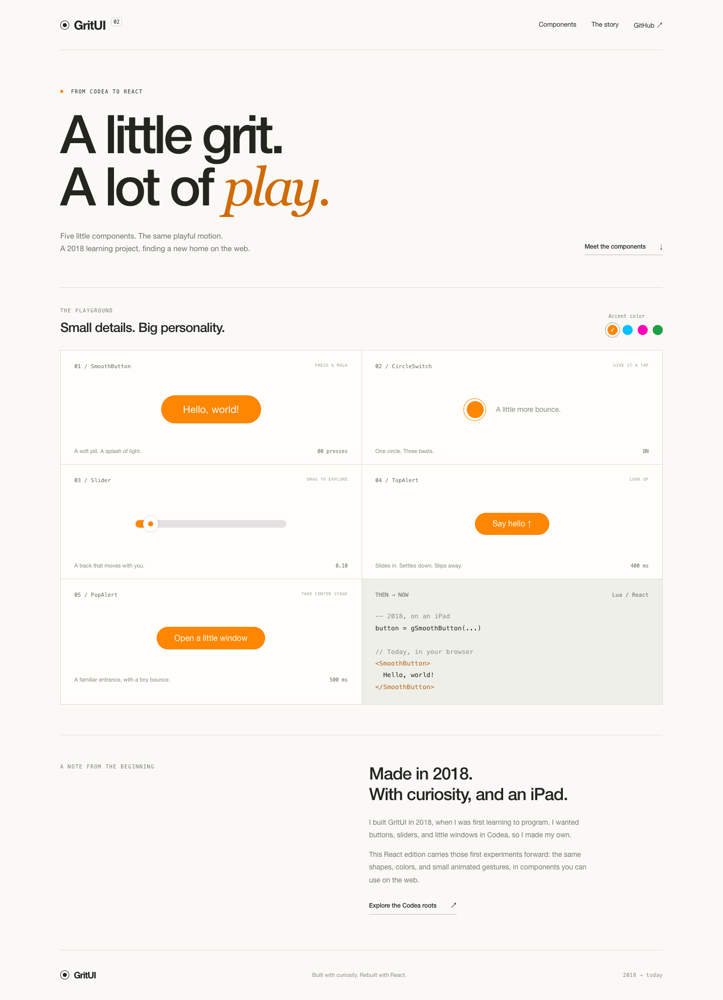

# GritUI

**Five playful React components, with their original Codea character.**

I built the original GritUI in **2018, when I was first learning to program**. It was a small Lua project for [Codea](https://codea.io/): I wanted buttons, sliders, switches, and windows in my projects, so I made my own.

This React edition brings those early experiments to the web. The pill buttons, circular switches, bright colors, and slightly bouncy entrances come from that original project. The implementation is new; the personality is familiar.



## Run the playground

Requires Node.js 22.12 or newer.

```sh
npm install
npm run dev
```

Open the local URL printed by Vite. The English playground includes all five components, a shared color palette, and interactive examples. `npm run build:demo` creates a standalone static demo in `demo-dist/`.

## Use the library

Build a local package from this repository:

```sh
npm ci
npm run build
npm pack
# In another React project:
npm install /path/to/gritui-2.0.0.tgz
```

The React rewrite is a local package until it is published; the commands above do not depend on an npm release. React and React DOM 18.2 or 19 are peer dependencies. The package ships ES modules and TypeScript declarations, with no runtime dependencies beyond React and React DOM.

```tsx
import { useState } from 'react';
import { CircleSwitch, Slider, SmoothButton, TopAlert, PopAlert } from 'gritui';
import 'gritui/styles.css';

export function Example() {
  const [enabled, setEnabled] = useState(true);
  const [value, setValue] = useState(0.1);
  const [notice, setNotice] = useState(false);
  const [dialog, setDialog] = useState(false);

  return (
    <>
      <CircleSwitch
        aria-label="Enable slider"
        checked={enabled}
        onCheckedChange={setEnabled}
      />
      <Slider
        aria-label="Amount"
        value={value}
        onValueChange={setValue}
        disabled={!enabled}
      />
      <SmoothButton onClick={() => setNotice(true)}>Say hello</SmoothButton>
      <SmoothButton onClick={() => setDialog(true)}>Open window</SmoothButton>
      <TopAlert open={notice} onOpenChange={setNotice} title="Hello!">
        Welcome to GritUI.
      </TopAlert>
      <PopAlert
        open={dialog}
        onOpenChange={setDialog}
        title="Keep exploring?"
        actions={[
          { label: 'Close' },
          { label: 'Say hello', onClick: () => setNotice(true) },
        ]}
      >
        A little window, carried forward from 2018.
      </PopAlert>
    </>
  );
}
```

## Components

Every component accepts `color`, `className`, and `style`. The default accent is the original orange, `#ff8600`. Each component's prop types are exported.

| Component | Main props | Original behavior |
| --- | --- | --- |
| `SmoothButton` | Native button props, `fontSize` (20) | Pill shape, white text, a white highlight expanding from the pointer in 200 ms; release fades over 1.25 s. |
| `CircleSwitch` | `checked`, `defaultChecked` (false), `onCheckedChange`, `size` (45) | Thin ring, filled center, three-stage 100 / 50 / 100 ms bounce when enabled; 100 / 100 ms collapse when disabled. `size` is the outer diameter. |
| `Slider` | `value`, `defaultValue`, `onValueChange`, `min` (0), `max` (1), `step` (`'any'`), `length` (300), `radius` (15), native range props | White thumb with colored center; track thickens in 100 ms during a drag and rebounds over 50 + 100 ms on release. |
| `TopAlert` | `open`, `onOpenChange`, `title`, `children`, `duration` (3000), `textColor` | Full-width top banner: 200 ms slide to a 6 px overshoot, 200 ms settle; 200 ms dip and 200 ms exit. |
| `PopAlert` | `open`, `onOpenChange`, `title`, `children`, `actions` | Square 350 px white panel, colored top rule, dark backdrop, two pill actions by default; 300 ms entrance with 10 px overshoot, 200 ms settle, 500 ms downward exit. |

### State and input

`CircleSwitch` and `Slider` support controlled and uncontrolled use. Use either `checked` / `value` with a change callback, or `defaultChecked` / `defaultValue`. Supply an accessible name with `aria-label` or, for the slider, a connected `<label>`. Native controls provide keyboard interaction: Space or Enter for buttons and switches; arrow keys, Home, and End for the range input.

Slider values use data units, rather than the old Lua API's initial pixel offset. Values are clamped to the range, including positive minima; reversed bounds collapse to `min`. Pointer input also supports tapping the track, and native range inputs supply stepping and keyboard behavior. `length` is the track length; the component's full width adds one thumb radius at each end and shrinks to fit its container.

`TopAlert` and `PopAlert` are controlled. Keep them mounted and set `open={false}` so their exit animation can finish. They render into `document.body` through portals. `TopAlert.duration` is in **milliseconds**, starting when it opens, as in the original; `0` keeps it visible. The timer requests dismissal through `onOpenChange(false)`. Reopening restarts the timer. Give a notification a new React `key` to replace and replay it while it is already open. Multiple banners overlap in mounting order, as in Codea; there is no notification queue.

`PopAlert` uses a native modal `<dialog>` for focus containment, background inertness, and Escape dismissal. It restores focus on exit. Actions run their optional callback and then request dismissal. Pass `actions` to customize the buttons; the default actions are **Cancel** and **OK**. Keep labels short for the original compact layout. Dialogs do not close on backdrop clicks. Modern browsers with native dialog support are required.

### Motion and fidelity

The Lua draw calls were translated into scoped CSS, preserving the original palette, proportions, animation stages, and timing. Helvetica Neue is used when available, with Helvetica and Arial fallbacks. The modal backdrop uses the original alpha of 195/255. The original source for comparison is in [`legacy/codea`](legacy/codea).

This is a source-based recreation, not a pixel-verified Codea capture. Canvas text metrics, the original rasterized shadows, and frame-based fading may look slightly different across browsers and displays. The button fade is normalized to the original 60 fps behavior. The switch previews its bounce on pointer-down and commits its state on activation. Native browser focus indicators, responsive sizing, and track clicking are intentional web adaptations. `prefers-reduced-motion` makes animations effectively instant while preserving state and dismissal timing.

## Project layout

```text
src/           React components, public types, and scoped styles
demo/         Interactive English playground
tests/        Component behavior and browser interaction tests
legacy/codea/ Historical Lua implementation and original API notes
```

The historical implementation is retained for reference. Its comments and demo copy have been made English; the untouched 2018 files remain in Git history. The React package does not execute Lua or make update-check network requests.

## Development

```sh
npm run typecheck
npm test
npm run build
npm run build:demo
# Browser tests use an installed Google Chrome by default.
npm run test:browser
```

`npm run build` produces `dist/index.js`, TypeScript declarations, and `dist/styles.css`. React is externalized. The browser suite exercises actual pointer dragging, keyboard access, focus restoration, notification dismissal, animation stages, mobile layout, and reduced motion.

## Roots

Created by **SoulWINTER** in 2018, originally for Codea. Rebuilt in React with the same curiosity that started it.
